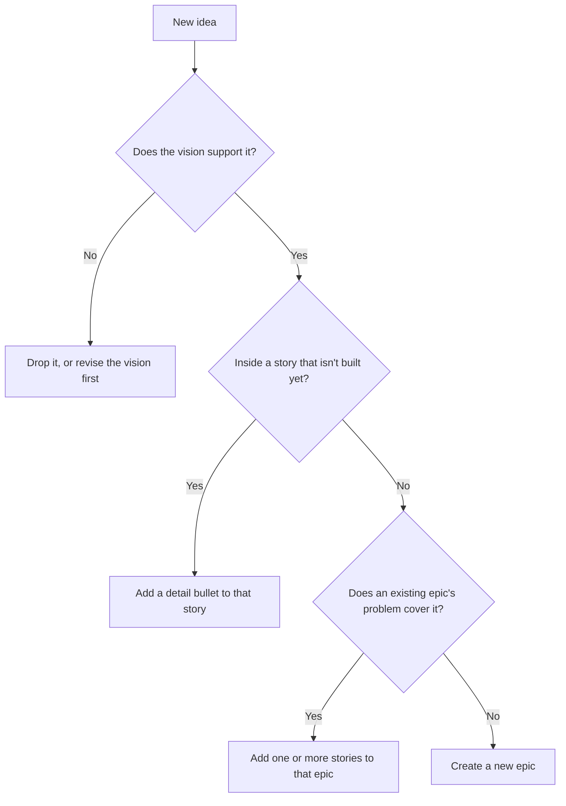

## Context

- The course is over. Nothing outside the team limits the format.
- The delivery workflow was just committed and hasn't been used yet. It mentions 1-pagers, the status table, and story points, so it changes too.
- No product spec exists yet, so every story is "not started".
- Story IDs, epic slugs, and epic numbers stay the same. Future spec paths don't move.
- OpenSpec limits:
  - A modified requirement can't drop a scenario. Three requirements are removed and re-added under new names instead.
  - Retiring a whole capability needs `retire_capabilities: true`. It is set.

## Non-Goals

- The branching model (`develop`, a tag per merge). That can be its own change later.
- Scripts or CI checks.
- Changing what detail bullets mean. Only persona names come out of them.

## Decisions

| Decision | Why | Rejected option |
|---|---|---|
| Remove personas | Most of what they forced is already a story or in the vision | Keep them frozen: every story still names them |
| Move two principles and four non-goals into the vision | Only personas enforced these | Drop them with the personas |
| Stories use "When…, I want to…, so that…" | The "When" keeps the context the persona gave | "As a user…": loses the context |
| Problem statements describe situations | Names with no persona file confuse readers | Keep names as example characters |
| Drop story points | Their only use was deciding when to split | T-shirt sizes: still a field nobody reads |
| Split a story when it won't fit in one change | That was the real question behind the 13-point limit | A size limit |
| Merge the 1-pager and story specs into `documentation/epics` | One spec to read when writing an epic | Keep two specs |
| Rename `one-pagers/` to `epics/`, FUNCTIONAL REQUIREMENTS to STORIES | Matches what the team calls them | Keep the course names |
| Derive status on demand (queries below) | The table went stale and caused merge conflicts | Keep the table |
| Backlog lists only what comes next | The rest was a copy of the epics | Keep "Not Yet Ordered" |
| Route new work by fit, not size (diagram below) | A big idea can belong to an existing epic | Route by size |
| Put the routing rule in `config.yaml` too | Explore reads config, not specs, and skills aren't in git | A custom explore skill |
| A change may add a detail bullet to its own story | Small gaps shouldn't need a new story | Always add a new story |
| Never amend a built story | Its status would become false | Allow it |
| Replace `drafts/` with git history | Git already keeps old versions | Keep `drafts/` |
| Writing rules live in `config.yaml` | Rules there shape every artifact | Fork the schema templates (experimental) |

### Routing new work



### Status queries

```sh
# implemented
grep -rhoE 'Realizes: .*' openspec/specs | grep -oE '[0-9]{2}-S[0-9]{2}' | sort -u
# in progress
grep -rhoE 'Realizes: .*' openspec/changes --exclude-dir=archive | grep -oE '[0-9]{2}-S[0-9]{2}' | sort -u
```

Process specs only use the placeholder `<NN>-S<NN>`, so they never match.

## Risks / Trade-offs

- **Rewording 52 stories could change their meaning.** Only the first clause changes. Each epic gets its own commit, so you can review it against the old text.
- **Stories could turn vague.** The "When" must describe a situation, not who someone is.
- **Status is harder to see at a glance.** The README shows the queries, and `openspec list` shows active work.
- **Explore might ignore the routing rule.** It's guidance, not enforced. The first explore will show whether it works.
- **The word limits could feel tight.** They're targets. Change them in `config.yaml`.

## Migration Plan

- This branch starts from `spec/process`. Rebase it onto `develop` after `spec/process` merges.
- After archiving, update two spec Purpose sections by hand. A delta can't change them.
- Archived changes keep their old wording.
